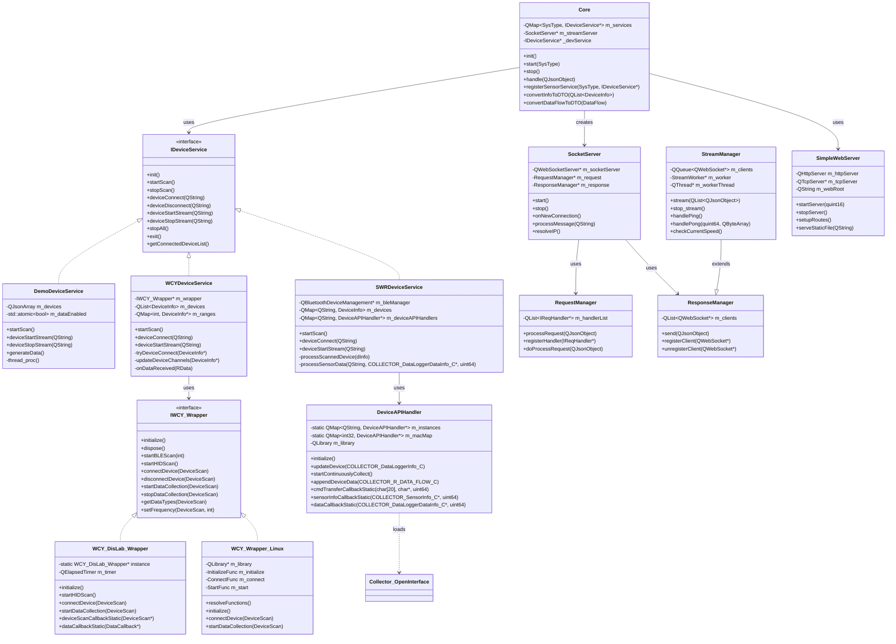
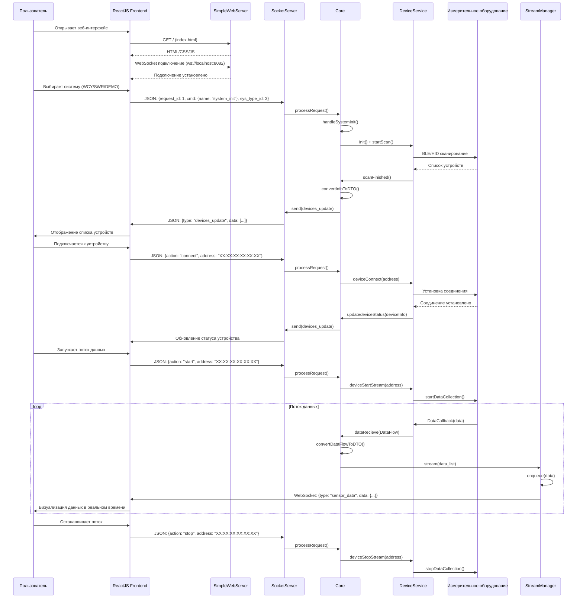

# EdTech-платформа для проведения лабораторных работ

## 📋 Постановка задачи

### Проблематика предметной области

В образовательных учреждениях при проведении лабораторных работ по физике, электротехнике и смежным дисциплинам существует ряд проблем:

- **Устаревший интерфейс ПО**: Большинство существующих решений для работы с измерительным оборудованием имеют устаревший десктопный интерфейс, не соответствующий современным стандартам UX
- **Ограниченная визуализация**: Данные с датчиков отображаются в виде простых графиков без возможности интерактивного анализа
- **Слабая масштабируемость**: Поддержка нового оборудования требует существенной переработки кода
- **Отсутствие кроссплатформенности**: Привязка к конкретной ОС ограничивает использование в учебных заведениях

### Цель проекта

Разработка программного комплекса для проведения и визуализации результатов лабораторных измерений в образовательных учреждениях, обеспечивающего:

- Современный пользовательский интерфейс на базе веб-технологий
- Поддержку различных производителей измерительного оборудования через унифицированный SDK
- Кроссплатформенность (Windows, Linux)
- Режим реального времени для отображения данных с датчиков
- Возможность экспорта и анализа результатов измерений

### Задачи проекта

1. **Архитектурное проектирование**: Разработка модульной архитектуры с четким разделением ответственности между компонентами
2. **Интеграция с оборудованием**: Реализация унифицированного интерфейса для работы с SDK различных производителей (SWR, WCY) и демо-режима
3. **Организация обмена данными**: Создание системы передачи данных между backend и frontend через WebSocket с использованием JSON
4. **Визуализация данных**: Разработка ReactJS-интерфейса для отображения и анализа измерительных данных
5. **Обеспечение расширяемости**: Создание механизмов для добавления поддержки новых производителей оборудования

---
## 📊 Функциональные требования

### 1: Управление системой измерений

| ID | Требование | Приоритет | Статус |
|----|-----------|-----------|--------|
| 1.1 | Система должна поддерживать инициализацию выбранного типа измерительной системы (DEMO, WCY, SWR) | Высокий | ✅ Реализовано |
| 1.2 | Система должна обеспечивать переключение между различными производителями оборудования без перезапуска приложения | Низкий | Ожидается |
| 1.3 | Система должна предоставлять информацию о поддерживаемых типах систем для каждой платформы | Низкий | ✅ Ожидается |

### 2: Обнаружение устройств

| ID | Требование | Приоритет | Статус |
|----|-----------|-----------|--------|
| 2.1 | Система должна выполнять сканирование BLE-устройств с заданным таймаутом | Высокий | ✅ Реализовано |
| 2.2 | Система должна выполнять сканирование HID (USB) устройств | Высокий | ✅ Реализовано |
| 2.3 | Система должна фильтровать устройства по заданным критериям (префикс имени) | Средний | ✅ Реализовано |
| 2.4 | Система должна уведомлять frontend о новых обнаруженных устройствах в реальном времени | Высокий | ✅ Реализовано |
| 2.5 | Система должна поддерживать повторное сканирование без потери подключенных устройств | Высокий | ✅ Реализовано |

### 3: Управление подключениями

| ID | Требование | Приоритет | Статус |
|----|-----------|-----------|--------|
| 3.1 | Система должна устанавливать соединение с выбранным устройством | Высокий | ✅ Реализовано |
| 3.2 | Система должна обрабатывать таймауты подключения (10 секунд) | Высокий | ✅ Реализовано |
| 3.3 | Система должна корректно разрывать соединение с устройством | Высокий | ✅ Реализовано |
| 3.4 | Система должна уведомлять frontend об изменении статуса подключения | Высокий | ✅ Реализовано |
| 3.5 | Система должна поддерживать одновременное подключение нескольких устройств | Средний | ✅ Реализовано |

### 4: Потоковая передача данных

| ID | Требование | Приоритет | Статус |
|----|-----------|-----------|--------|
| 4.1 | Система должна запускать поток данных с выбранного устройства | Высокий | ✅ Реализовано |
| 4.2 | Система должна останавливать поток данных с устройства | Высокий | ✅ Реализовано |
| 4.3 | Система должна поддерживать одновременный стриминг с нескольких устройств | Средний | ✅ Реализовано |
| 4.4 | Система должна автоматически определять частоту дискретизации устройства | Средний | ✅ Реализовано |
| 4.5 | Система должна генерировать временные метки для каждого пакета данных | Высокий | ✅ Реализовано |

### 5: Визуализация данных

| ID | Требование | Приоритет | Статус |
|----|-----------|-----------|--------|
| 5.1 | Frontend должен отображать данные с датчиков в реальном времени | Высокий | ✅ Реализовано |
| 5.2 | Frontend должен поддерживать отображение нескольких графиков одновременно | Средний | ✅ Реализовано |
| 5.3 | Frontend должен предоставлять возможность экспорта данных | Средний | ✅ Реализовано |
| 5.4 | Frontend должен отображать статистику по устройствам (частота, статус) | Низкий | ✅ Реализовано |

### 6: API и интеграция

| ID | Требование | Приоритет | Статус |
|----|-----------|-----------|--------|
| 6.1 | Система должна предоставлять API для получения данных и передачи команд | Средний | ✅ Реализовано |
| 6.2 | Система должна поддерживать WebSocket-соединения для обмена данными | Высокий | ✅ Реализовано |
| 6.3 | Система должна обслуживать статические файлы ReactJS-приложения | Высокий | ✅ Реализовано |
| 6.4 | Система должна поддерживать SPA-роутинг (fallback на index.html) | Средний | ✅ Реализовано |
| 6.5 | Система должна предоставлять endpoint для экспорта данных | Средний | ✅ Реализовано |

---

## ⚙️ Нефункциональные требования

### 1: Производительность

| ID | Требование | Метрика | Статус |
|----|-----------|---------|--------|
| 1.1 | Задержка передачи данных от датчика до frontend | < 100 мс | ✅ Достигнуто |
| 1.2 | Пропускная способность WebSocket-соединения | > 1000 сообщений/сек | ✅ Достигнуто |
| 1.3 | Время отклика на обработку запросов от fronend | < 50 мс | ✅ Достигнуто |
| 1.4 | Время запуска приложения | < 3 сек | ✅ Достигнуто |
| 1.5 | Потребление оперативной памяти | < 200 МБ | ✅ Достигнуто |

### 2: Надежность

| ID | Требование | Метрика | Статус |
|----|-----------|---------|--------|
| 2.1 | Время безотказной работы | > 8 часов | ✅ Достигнуто |
| 2.2 | Автоматическое восстановление при потере соединения | < 5 сек | ✅ Реализовано |
| 2.3 | Возможность восстановления без перегрузки в случае зависания/падения fronend | < 5 сек | Ожидается |
| 2.4 | Корректная обработка исключений SDK | 100% | ✅ Реализовано |
| 2.5 | Защита от утечек памяти при работе с C-API | Валидация | ✅ Реализовано |

### 3: Совместимость

| ID | Требование | Статус |
|----|-----------|--------|
| 3.1 | Поддержка Windows 10/11 | ✅ Реализовано |
| 3.2 | Поддержка Linux (Ubuntu 20.04+) | ✅ Реализовано |
| 3.3 | Поддержка Qt 6.5+ | ✅ Реализовано |
| 3.4 | Поддержка современных браузеров (Chrome, Firefox, Edge) | ✅ Реализовано |
| 3.5 | Поддержка Bluetooth 4.0+ (BLE) | ✅ Реализовано |
| 3.6 | Поддержка USB HID | ✅ Реализовано |

### NFR-4: Масштабируемость

| ID | Требование | Статус |
|----|-----------|--------|
| 4.1 | Возможность добавления нового производителя через реализацию IDeviceService | ✅ Реализовано |
| 4.2 | Возможность добавления нового SDK через реализацию IWCY_Wrapper | ✅ Реализовано |
| 4.3 | Возможность добавления новых API endpoints | ✅ Реализовано |
| 4.4 | Возможность добавления новых типов визуализации на frontend | ✅ Реализовано |

### NFR-5: Безопасность

| ID | Требование | Статус |
|----|-----------|--------|
| 5.1 | Валидация входящих JSON-сообщений | ✅ Реализовано |
| 5.2 | Ограничение доступа к файловой системе (только webRoot) | ✅ Реализовано |
| 5.3 | CORS-заголовки для API | ✅ Реализовано |

### NFR-6: Удобство использования

| ID | Требование | Статус |
|----|-----------|--------|
| 6.1 | Интуитивно понятный интерфейс на русском языке | ✅ Реализовано |
| 6.2 | Адаптивный дизайн для различных разрешений экрана | ✅ Реализовано |
| 6.3 | Визуальная индикация состояния устройств | ✅ Реализовано |
| 6.4 | Автоматическое обновление статистики | ✅ Реализовано |

---

## 🏗️ Архитектурный дизайн

### Общая архитектура системы

```
┌─────────────────────────────────────────────────────────────────────────────┐
│                           Desktop Application (Qt/QML/C++)                    │
│                                                                              │
│  ┌────────────────────────────────────────────────────────────────────────┐ │
│  │                         Presentation Layer                             │ │
│  │  ┌─────────────────┐  ┌─────────────────┐  ┌─────────────────────────┐ │ │
│  │  │   QML Window    │  │   WebView       │  │   Native Controls       │ │ │
│  │  │   (Main.qml)    │  │   (ReactJS)     │  │   (QMainWindow)         │ │ │
│  │  └─────────────────┘  └────────┬────────┘  └─────────────────────────┘ │ │
│  └─────────────────────────────────┼──────────────────────────────────────┘ │
│                                    │ HTTP/WebSocket                         │
│  ┌─────────────────────────────────▼──────────────────────────────────────┐ │
│  │                         Application Layer                              │ │
│  │  ┌──────────────────────────────────────────────────────────────────┐  │ │
│  │  │                     SimpleWebServer / AdvancedWebServer          │  │ │
│  │  │  ┌─────────────┐ ┌─────────────┐ ┌─────────────┐ ┌─────────────┐ │  │ │
│  │  │  │ Static File │ │  REST API   │ │  WebSocket  │ │   Cache     │ │  │ │
│  │  │  │  Serving    │ │  Endpoints  │ │  Upgrade    │ │   Manager   │ │  │ │
│  │  │  └─────────────┘ └─────────────┘ └─────────────┘ └─────────────┘ │  │ │
│  │  └──────────────────────────────────────────────────────────────────┘  │ │
│  │                                                                        │ │
│  │  ┌──────────────────────────────────────────────────────────────────┐  │ │
│  │  │                         SocketServer                             │  │ │
│  │  │  ┌─────────────┐ ┌─────────────┐ ┌─────────────┐ ┌─────────────┐ │  │ │
│  │  │  │  Request    │ │  Response   │ │   Stream    │ │   Client    │ │  │ │
│  │  │  │  Manager    │ │  Manager    │ │   Manager   │ │   Registry  │ │  │ │
│  │  │  └─────────────┘ └─────────────┘ └─────────────┘ └─────────────┘ │  │ │
│  │  └──────────────────────────────────────────────────────────────────┘  │ │
│  └────────────────────────────────────────────────────────────────────────┘ │
│                                                                             │
│  ┌────────────────────────────────────────────────────────────────────────┐ │
│  │                         Domain Layer                                   │ │
│  │  ┌──────────────────────────────────────────────────────────────────┐  │ │
│  │  │                            Core                                  │  │ │
│  │  │  ┌─────────────┐ ┌─────────────┐ ┌─────────────┐ ┌─────────────┐ │  │ │
│  │  │  │  Command    │ │Sensor servic│ │   Data      │ │   System    │ │  │ │
│  │  │  │  Handler    │ │  Registry   │ │  Converter  │ │   Types     │ │  │ │
│  │  │  └─────────────┘ └─────────────┘ └─────────────┘ └─────────────┘ │  │ │
│  │  └──────────────────────────────────────────────────────────────────┘  │ │
│  │                                                                        │ │
│  │  ┌──────────────────────────────────────────────────────────────────┐  │ │
│  │  │                    IDeviceService (Interface)                     │  │ │
│  │  │  ┌─────────────────┐ ┌─────────────────┐ ┌─────────────────────┐ │  │ │
│  │  │  │ DemoDeviceService│ │ WCYDeviceService│ │ SWRDeviceService   │ │  │ │
│  │  │  └─────────────────┘ └─────────────────┘ └─────────────────────┘ │  │ │
│  │  └──────────────────────────────────────────────────────────────────┘  │ │
│  └────────────────────────────────────────────────────────────────────────┘ │
│                                                                             │
│  ┌────────────────────────────────────────────────────────────────────────┐ │
│  │                      Infrastructure Layer                              │ │
│  │  ┌─────────────────┐  ┌─────────────────┐  ┌─────────────────────────┐ │ │
│  │  │  IWCY_Wrapper   │  │  DeviceAPI      │  │  Bluetooth Manager      │ │ │
│  │  │  (Abstract)     │  │  Handler        │  │  (QtBluetooth)          │ │ │
│  │  └────────┬────────┘  └─────────────────┘  └─────────────────────────┘ │ │
│  │           │                                                            │ │
│  │  ┌────────▼────────┐  ┌─────────────────┐  ┌─────────────────────────┐ │ │
│  │  │ WCY_DisLab_     │  │ WCY_Wrapper_    │  │  QLowEnergyController   │ │ │
│  │  │ Wrapper (Win)   │  │ Linux (QLibrary)│  │  QBluetoothDeviceDiscovery│ │ │
│  │  └─────────────────┘  └─────────────────┘  └─────────────────────────┘ │ │
│  │                                                                        │ │
│  │  ┌──────────────────────────────────────────────────────────────────┐  │ │
│  │  │                    External SDKs (C/C++)                         │  │ │
│  │  │  ┌─────────────────┐ ┌─────────────────┐ ┌─────────────────────┐ │  │ │
│  │  │  │ WCY_DisLab_SDK  │ │ Collector_Open  │ │  Системные          │ │  │ │
│  │  │  │ (Windows/Linux) │ │ Interface       │ │  библиотеки (dl)    │ │  │ │
│  │  │  └─────────────────┘ └─────────────────┘ └─────────────────────┘ │  │ │
│  │  └──────────────────────────────────────────────────────────────────┘  │ │
│  └────────────────────────────────────────────────────────────────────────┘ │
└─────────────────────────────────────────────────────────────────────────────┘
```

### Диаграмма классов основных компонентов



### Диаграмма последовательности (основной сценарий работы)



### Структура базы данных (in-memory)

```
┌─────────────────────────────────────────────────────────────────────────────┐
│                           In-Memory Data Structures                          │
├─────────────────────────────────────────────────────────────────────────────┤
│                                                                              │
│  ┌────────────────────────────────────────────────────────────────────────┐ │
│  │                         DeviceInfo (struct)                             │ │
│  │  ┌──────────────────────────────────────────────────────────────────┐  │ │
│  │  │ id: int                    // Внутренний уникальный номер         │  │ │
│  │  │ deviceId: QString          // Внешний ID (например, "A3A3")      │  │ │
│  │  │ deviceName: QString        // Полное имя устройства               │  │ │
│  │  │ deviceMac: QString         // MAC-адрес                           │  │ │
│  │  │ deviceType: QString        // Тип устройства                      │  │ │
│  │  │ displayType: QString       // Отображаемое имя                    │  │ │
│  │  │ connectType: CONNECT_TYPE  // USB/BLE/COM                         │  │ │
│  │  │ connectState: CONNECT_STATE // Scanned/Connected/Started/...      │  │ │
│  │  │ frequency: int             // Частота опроса (Гц)                 │  │ │
│  │  │ channels[10]: ChannelInfo  // Массив каналов                      │  │ │
│  │  └──────────────────────────────────────────────────────────────────┘  │ │
│  └────────────────────────────────────────────────────────────────────────┘ │
│                                                                              │
│  ┌────────────────────────────────────────────────────────────────────────┐ │
│  │                         ChannelInfo (struct)                            │ │
│  │  ┌──────────────────────────────────────────────────────────────────┐  │ │
│  │  │ id: int                    // ID канала                           │  │ │
│  │  │ symbol: QString            // Условное обозначение (U, I, P, T)  │  │ │
│  │  │ name: QString              // Название канала                     │  │ │
│  │  │ baseUnit: int              // Базовая единица измерения           │  │ │
│  │  │ availableUnits[5]: int     // Доступные единицы                   │  │ │
│  │  │ decimal: int32             // Количество знаков после запятой     │  │ │
│  │  │ minValue: double           // Минимальное значение                │  │ │
│  │  │ maxValue: double           // Максимальное значение               │  │ │
│  │  └──────────────────────────────────────────────────────────────────┘  │ │
│  └────────────────────────────────────────────────────────────────────────┘ │
│                                                                              │
│  ┌────────────────────────────────────────────────────────────────────────┐ │
│  │                         DataFlow (struct)                               │ │
│  │  ┌──────────────────────────────────────────────────────────────────┐  │ │
│  │  │ deviceMac: QString         // MAC-адрес устройства                │  │ │
│  │  │ timestamp: int64           // Временная метка (микросекунды)      │  │ │
│  │  │ values: map<int, double>   // Значения по каналам                 │  │ │
│  │  └──────────────────────────────────────────────────────────────────┘  │ │
│  └────────────────────────────────────────────────────────────────────────┘ │
│                                                                              │
│  ┌────────────────────────────────────────────────────────────────────────┐ │
│  │                    ResponseManager::m_clients                           │ │
│  │  ┌──────────────────────────────────────────────────────────────────┐  │ │
│  │  │ QList<QWebSocket*>          // Список подключенных клиентов       │  │ │
│  │  └──────────────────────────────────────────────────────────────────┘  │ │
│  └────────────────────────────────────────────────────────────────────────┘ │
│                                                                              │
│  ┌────────────────────────────────────────────────────────────────────────┐ │
│  │                    StreamManager::m_clients                             │ │
│  │  ┌──────────────────────────────────────────────────────────────────┐  │ │
│  │  │ QQueue<QWebSocket*>         // Очередь клиентов для стриминга     │  │ │
│  │  └──────────────────────────────────────────────────────────────────┘  │ │
│  └────────────────────────────────────────────────────────────────────────┘ │
│                                                                              │
│  ┌────────────────────────────────────────────────────────────────────────┐ │
│  │                    SimpleWebServer::m_httpServer                        │ │
│  │  ┌──────────────────────────────────────────────────────────────────┐  │ │
│  │  │ QHttpServer                 // HTTP-сервер для статики и REST API │  │ │
│  │  └──────────────────────────────────────────────────────────────────┘  │ │
│  └────────────────────────────────────────────────────────────────────────┘ │
└─────────────────────────────────────────────────────────────────────────────┘
```

---

## 🔧 Технологический стек

### Backend

| Технология | Версия | Назначение |
|-----------|--------|-----------|
| **C++** | 17 | Основной язык разработки |
| **Qt Framework** | 6.5+ | Кроссплатформенный фреймворк |
| **Qt HttpServer** | 6.5+ | Встроенный HTTP-сервер |
| **Qt WebSockets** | 6.5+ | WebSocket-соединения |
| **Qt Bluetooth** | 6.5+ | Работа с BLE |
| **Qt Concurrent** | 6.5+ | Многопоточность |
| **CMake** | 3.16+ | Система сборки |
| **QLibrary** | 6.5+ | Динамическая загрузка SDK |

### Frontend

| Технология | Версия | Назначение |
|-----------|--------|-----------|
| **ReactJS** | 18+ | UI-фреймворк |
| **WebSocket API** | - | Обмен данными в реальном времени |
| **Fetch API** | - | API запросы |
| **Chart.js / Recharts** | - | Визуализация данных |
| **CSS3** | - | Стилизация |

### Интеграции

| SDK | Производитель | Платформа | Назначение |
|-----|--------------|-----------|-----------|
| **WCY_DisLab_SDK** | WCY | Windows/Linux | Работа с измерительными приборами |
| **Collector_OpenInterface** | SWR | Windows/Linux | Работа с BLE-датчиками |
| **Demo Mode** | - | Все | Демонстрация без оборудования |

---

## 📁 Структура проекта

```
sensors/
├── CMakeLists.txt                          # Конфигурация сборки
├── main.cpp                                # Точка входа
├── core.h / core.cpp                       # Ядро системы
├── types.h                                 # Общие типы и интерфейсы
├── ireqhandler.h                           # Интерфейс обработчика запросов
├── basereqhandler.h / basereqhandler.cpp   # Базовый обработчик
├── requestmanager.h / requestmanager.cpp   # Менеджер запросов
├── responsemanager.h / responsemanager.cpp # Менеджер ответов
├── streammanager.h / streammanager.cpp     # Менеджер потоков данных
├── socketserver.h / socketserver.cpp       # WebSocket-сервер
├── simplewebserver.h / simplewebserver.cpp # HTTP-сервер для статики
├── advancedwebserver.h / advancedwebserver.cpp # Расширенный HTTP-сервер
├── demodeviceservice.h / demodeviceservice.cpp # Демо-режим
├── wcydeviceservice.h / wcydeviceservice.cpp # Сервис WCY
├── swrdeviceservice.h / swrdeviceservice.cpp # Сервис SWR
├── iwcy_wrapper.h                          # Интерфейс обёртки WCY
├── wcy_dislab_wrapper.h / wcy_dislab_wrapper.cpp # Обёртка WCY для Windows
├── wcy_wrapper_linux.h / wcy_wrapper_linux.cpp   # Обёртка WCY для Linux
├── device_generator.h                      # Генератор устройств для демо
├── Main.qml                                # QML-интерфейс
├── front/                                  # ReactJS-приложение
│   ├── build/                              # Собранное приложение
│   │   ├── index.html
│   │   ├── static/
│   │   │   ├── css/
│   │   │   └── js/
│   │   └── asset-manifest.json
│   └── src/                                # Исходники React
├── swr/                                    # Компоненты SWR
│   ├── deviceapihandler.h / deviceapihandler.cpp
│   ├── QBluetoothBase.h / QBluetoothBase.cpp
│   ├── qbluetoothdevicemanagement.h / qbluetoothdevicemanagement.cpp
│   ├── QLowEnergyBluetooth.h / QLowEnergyBluetooth.cpp
│   ├── QStandardBluetooth.h / QStandardBluetooth.cpp
│   └── dataloggerstructinfo.h
├── lib/                                    # Внешние SDK
│   ├── WCY_DisLab_SDK.h
│   ├── WCY_DisLab_SDK.lib / WCY_DisLab_SDK.dll (Windows)
│   ├── libwcy_dislab_sdk.so (Linux)
│   ├── collector_openinterface.dll (Windows)
│   └── libcollector_openinterface.so (Linux)
└── config/                                 # Конфигурационные файлы
```

---

## 🎯 Ключевые архитектурные решения

### 1. Паттерн Chain of Responsibility для обработки запросов

```cpp
// Цепочка обработчиков: Core -> BaseReqHandler -> ...
// Каждый обработчик решает, может ли он обработать запрос
int Core::handle(const QJsonObject &request) {
    QString cmdName = request.value("cmd").toObject().value("name").toString();
    
    if (cmdName == CMD_SYSTEM_INIT) {
        handleSystemInit(request);
        return 1;
    }
    
    // Передача следующему обработчику
    return BaseReqHandler::handle(request);
}
```

**Преимущества:**
- Гибкость в добавлении новых обработчиков
- Разделение ответственности
- Возможность динамического изменения цепочки

### 2. Паттерн Strategy для работы с оборудованием

```cpp
class IDeviceService : public QObject {
public:
    virtual void init() = 0;
    virtual void startScan() = 0;
    virtual void deviceConnect(const QString& deviceMac) = 0;
    // ...
};

// Конкретные реализации
class DemoDeviceService : public IDeviceService { /* ... */ };
class WCYDeviceService : public IDeviceService { /* ... */ };
class SWRDeviceService : public IDeviceService { /* ... */ };
```

**Преимущества:**
- Единый интерфейс для всех производителей
- Легкость добавления нового оборудования
- Изоляция специфики SDK

### 3. Паттерн Singleton для менеджеров

```cpp
class RequestManager {
public:
    static RequestManager* instance() {
        static RequestManager i;
        return &i;
    }
    // ...
};

class ResponseManager {
public:
    static ResponseManager* instance() {
        static ResponseManager i;
        return &i;
    }
};

class StreamManager : public ResponseManager {
public:
    static StreamManager* instance() {
        static StreamManager i;
        return &i;
    }
};
```

**Преимущества:**
- Глобальный доступ к менеджерам
- Единая точка управления клиентами

### 4. Применение подхода по внедрению зависимостей

```cpp
    IWCY_Wrapper* wcyWrapper = new WCY_DisLab_Wrapper();
    auto wcy = new WCYDeviceService(wcyWrapper);
    registerSensorService(SysType::WCY, wcy);
    // SWR Device Service
    auto swrService = new SWRDeviceService();
    registerSensorService(SysType::SWR, swrService);
```

**Преимущества:**
- Ослабление связанности
- Кроссплатформенность через подмену реализации
- Гибкость конфигурирования
- Тестируемость

### 5. Многопоточная обработка данных

```cpp
// StreamWorker в отдельном потоке
class StreamWorker : public QObject {
    Q_OBJECT
public slots:
    void process() {
        while (true) {
            QMutexLocker locker(&m_mutex);
            if (m_queue.isEmpty()) {
                m_waitCondition.wait(&m_mutex);
                continue;
            }
            QJsonObject obj = m_queue.dequeue();
            locker.unlock();
            emit sendData(obj);
        }
    }
};

// Запуск в отдельном потоке
m_worker = new StreamWorker();
m_workerThread = new QThread();
m_worker->moveToThread(m_workerThread);
connect(m_workerThread, &QThread::started, m_worker, &StreamWorker::process);
m_workerThread->start();
```

**Преимущества:**
- Неблокирующая обработка данных
- Плавный UI даже при высокой нагрузке
- Эффективное использование многоядерных процессоров

### 6. Кроссплатформенная загрузка SDK

```cpp
// Windows: статическая линковка
#ifdef Q_OS_WIN
    #include "wcy_dislab_wrapper.h"
    IWCY_Wrapper* wcyWrapper = new WCY_DisLab_Wrapper();
#endif

// Linux: динамическая загрузка через QLibrary
#ifdef Q_OS_LINUX
    class WCY_Wrapper_Linux : public IWCY_Wrapper {
        QLibrary* m_library;
        InitializeFunc m_initialize;
        ConnectFunc m_connect;
        // ...
    };
#endif
```

**Преимущества:**
- Единый интерфейс для разных платформ
- Возможность обновления SDK без пересборки
- Обработка отсутствия библиотеки

---

## 🚀 Достижения и особенности реализации

### 1. Гибридный интерфейс (Native + Web)

- **Native-часть (Qt/QML)**: Управление окном, системные вызовы, работа с оборудованием
- **Web-часть (ReactJS)**: Современный UI, визуализация данных, интерактивность
- **Мост**: Встроенный HTTP/WebSocket сервер для связи между частями

**Преимущества:**
- Современный UI без потери производительности
- Возможность обновления интерфейса без пересборки приложения
- Использование лучших инструментов для каждой задачи

### 2. Унифицированный формат данных

```json
// Обновление списка устройств
{
    "type": "devices_update",
    "data": [
        {
            "id": "A3A3",
            "address": "38:3B:26:E8:A3:3A",
            "name": "VM-1001_A3A3",
            "type": "voltmeter",
            "displayType": "вольтметр",
            "connType": "USB",
            "connected": true,
            "frequency": 100,
            "channels": [
                {
                    "id": 1,
                    "name": "U",
                    "symbol": "voltage",
                    "unit": 3,
                    "availableUnits": [2, 3],
                    "decimal": 2,
                    "minValue": 0,
                    "maxValue": 1000
                }
            ]
        }
    ]
}

// Данные с датчиков
{
    "type": "sensor_data",
    "data": {
        "address": "38:3B:26:E8:A3:3A",
        "data": {
            "0": 1234567890123456,  // timestamp в микросекундах
            "1": 12.34,             // значение канала 1
            "18": 0.56              // значение канала 18
        }
    }
}
```

### 3. Поддержка множества производителей

| Производитель | Тип подключения | SDK | Особенности |
|--------------|----------------|-----|-------------|
| **WCY** | USB HID, BLE | WCY_DisLab_SDK | Прямая работа через C API |
| **SWR** | BLE | Collector_OpenInterface | Работа через промежуточный API |
| **Demo** | - | Встроенный | Генерация синтетических данных |

### 4. Режим реального времени

- **Частота обновления**: до 1000 Гц
- **Задержка**: < 100 мс
- **Буферизация**: адаптивная, в зависимости от скорости канала
- **Синхронизация**: временные метки в микросекундах

### 5. Обработка ошибок и восстановление

```cpp
// Таймауты подключения
QTimer* timeoutTimer = new QTimer(this);
timeoutTimer->setSingleShot(true);
timeoutTimer->setProperty("deviceMac", deviceMac);
connect(timeoutTimer, &QTimer::timeout, this, &SWRDeviceService::onDeviceConnectionTimeout);
timeoutTimer->start(10000); // 10 секунд

// Повторные попытки подключения
auto ret = tryDeviceConnect(device);
if (ret == _return_FAIL) {
    QTimer::singleShot(3000, [this, device]() {
        tryDeviceConnect(device);
    });
}
```

---

## 📈 Результаты и выводы

### Достигнутые результаты

1. **Разработана модульная архитектура**, позволяющая легко добавлять новых производителей оборудования
2. **Реализован гибридный интерфейс**, сочетающий производительность нативного кода и гибкость веб-технологий
3. **Обеспечена кроссплатформенность** (Windows, Linux) с единой кодовой базой
4. **Достигнута высокая производительность** передачи данных (до 1000 Гц, задержка < 100 мс)
5. **Создана система адаптивного стриминга**, автоматически подстраивающаяся под пропускную способность канала
6. **Реализована поддержка трех типов устройств** (WCY, SWR, Demo) через унифицированный интерфейс

### Приобретенные навыки

- **Архитектурное проектирование**: Разработка модульных систем с четким разделением ответственности
- **Интеграция с оборудованием**: Работа с C/C++ SDK, динамическая загрузка библиотек, обработка callback'ов
- **Многопоточность**: Использование QThread, QtConcurrent, мьютексов, условных переменных
- **Веб-технологии**: Создание HTTP/WebSocket серверов, работа с JSON, обслуживание SPA
- **Кроссплатформенная разработка**: Учет особенностей Windows и Linux, работа с QLibrary
- **Паттерны проектирования**: Chain of Responsibility, Strategy, Singleton, Observer

### Возможные направления развития

1. **Добавление поддержки новых производителей** через реализацию IDeviceService
2. **Расширение функционала визуализации** (3D-графики, спектральный анализ)
3. **Интеграция с системами управления обучением** (Moodle, Canvas)
4. **Добавление облачной синхронизации** результатов измерений
5. **Разработка мобильного приложения** для удаленного мониторинга
6. **Внедрение машинного обучения** для анализа аномалий в данных

---

**Репозиторий**: [https://gitlab.com/ashvabsky/sensors.git](https://gitlab.com/ashvabsky/sensors.git)

**Лицензия**: 
Проект только для использования в учебных заведениях для учебных целей. Автор проекта Коновалов Алексей. Разработчики Александр Швабский(core), Губанова Лиза (frontend). Все права защищены.
